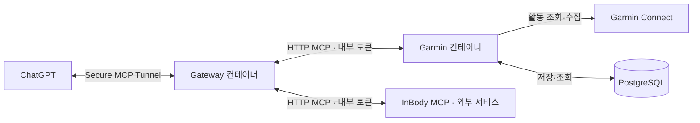

# 서비스 구조

이 저장소는 Garmin MCP와 MCP 게이트웨이를 **별도 Docker 이미지 두 개**로 관리합니다. 루트 `docker-compose.yml`에는 `garmin`, `gateway` 두 서비스만 있습니다. InBody MCP와 PostgreSQL은 이 Compose 밖에서 운영합니다.

Garmin 컨테이너는 수집기와 MCP 서버를 실행하며 터널 클라이언트는 포함하지 않습니다. 게이트웨이 컨테이너가 하위 MCP의 도구 목록을 읽고 `garmin_`, `inbody_` 이름으로 제공하며, 터널 클라이언트도 이 컨테이너에서 실행합니다.

| 경로 | 역할 |
| --- | --- |
| `services/garmin/` | Garmin 코드와 Dockerfile |
| `services/gateway/` | 게이트웨이 코드와 Dockerfile |
| `scripts/build-garmin.sh`, `scripts/build-gateway.sh` | 이미지별 빌드 |
| `runtime/garmin/`, `runtime/gateway/` | 실행 설정·토큰·데이터. 안내 문서만 Git 포함 |
| `scripts/init-gateway.py` | 게이트웨이 설정과 자체 토큰을 호스트에서 처음 준비. 별도 컨테이너 없음 |

게이트웨이는 호스트 네트워크에서 기본적으로 Garmin `127.0.0.1:18765/mcp`, InBody `127.0.0.1:18766/mcp`에 연결합니다. 실제 배포 주소는 `runtime/gateway/gateway.yaml`에서 정합니다. 실행 방법과 NAS 설정은 루트 [README](../README.md)를 참고하세요.
